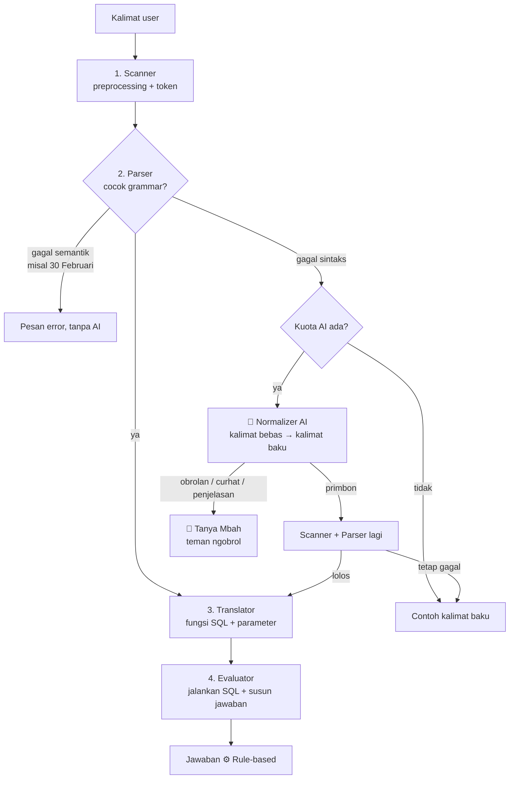

# Cara Kerja Primbon NLP

Dokumen ini adalah bahan presentasi: menjelaskan setiap tahap mesin penterjemah, aturan produksi, data, dan pembagian peran AI dengan rule-based. Semua contoh jejak di bawah adalah **output asli** mesin (`src/lib/nlp/`), bukan ilustrasi.

## 1. Prinsip: AI menerjemahkan, rule-based menjawab

> Semua jawaban primbon (weton, neptu, jodoh, tanggal, watak) **selalu dihitung oleh mesin rule-based**. AI hanya menulis ulang kalimat yang terlalu bebas menjadi kalimat baku, dan kalimat hasil AI **wajib lolos Parser yang sama**.



| Tugas | Rule-based | AI |
|---|---|---|
| Mengenali kalimat baku | Ya | Tidak dipanggil sama sekali |
| Mengenali kalimat bebas ("aku senin legi, pacarku jumat kliwon, cocok ga?") | Tidak | Ya, ditulis ulang jadi kalimat baku |
| Menghitung weton, neptu, jodoh, tanggal, watak | **Selalu** | **Tidak pernah** |
| Memvalidasi hasil AI | Ya, lewat Parser yang sama | Tidak |
| Ngobrol, curhat, pertanyaan umum, penjelasan hasil lebih rinci, pertanyaan tentang aplikasi | Tidak | Ya, Tanya Mbah (tanpa menghitung) |

Di aplikasi, setiap jawaban diberi label: **⚙️ Rule-based**, **⚙️ Rule-based · ✨ kalimat dirapikan AI**, atau **✨ Mbah AI**.

## 2. Pemetaan ke butir tugas

| Butir tugas | Di Primbon NLP |
|---|---|
| 1. Tema kearifan lokal | Weton dan primbon Jawa |
| 2. 3-5 tipe kalimat | 5 tipe: WETON, NEPTU, JODOH, KAPAN, WATAK (bagian 3) |
| 3. Aturan produksi | R1-R14 (bagian 5) |
| 4. Scanner, Parser, Translator, Evaluator | `src/lib/nlp/scanner.ts`, `parser.ts`, `translator.ts`, `evaluator.ts` |
| 5. Dokumen + implementasi | Dokumen ini, PRD, panel tahapan di aplikasi, dan kode sumber |

## 3. Lima tipe kalimat

| Tipe | Kalimat baku | Contoh jawaban |
|---|---|---|
| WETON | apa weton orang yang lahir tanggal 17 agustus 2003 | Minggu Kliwon |
| NEPTU | berapa neptu weton senin legi | Senin (4) + Legi (5) = 9 |
| JODOH | apakah weton senin legi cocok dengan jumat kliwon | 9 + 14 = 23 → 23 mod 9 = 5 → Tinari |
| KAPAN | kapan jumat kliwon berikutnya | 30 Oktober 2026 (dari 25 Oktober 2026) |
| WATAK | bagaimana watak orang dengan weton rabu pon | Gigih dan mudah bergaul… |

Variasi yang tetap dikenali tanpa AI: subjek boleh berupa tanggal ("berapa neptu orang yang lahir tanggal 17/08/1945"), kata `weton`, `orang yang`, `pada`, dan `di` boleh ada atau tidak, serta sinonim seperti `ahad`, `manis`, `gimana`, `tgl`.

## 4. Tahap 1: Scanner

File: `src/lib/nlp/scanner.ts`

1. Huruf kecil.
2. Tanggal angka diubah: `17/8/2003`, `17-08-2003`, `17.08.2003` → `17 agustus 2003`.
3. Apostrof dihapus (`jum'at` → `jumat`), tanda baca lain diganti spasi.
4. Kamus sinonim: `ahad → minggu`, `manis → legi`, `kaliwon → kliwon`, `paing → pahing`, singkatan bulan (`agt`, `okt`, ...), `gimana → bagaimana`, `brp → berapa`, `tgl → tanggal`, `yg → yang`, `sama → dengan`, `terdekat → berikutnya`, dan lainnya.
5. Setiap token diberi kelas:

| Kelas | Isi |
|---|---|
| KATA_TANYA | apa, berapa, apakah, kapan, bagaimana |
| KATA_KUNCI | weton, neptu, cocok, watak, lahir, tanggal, berikutnya, bulan |
| HARI | senin ... minggu |
| PASARAN | legi, pahing, pon, wage, kliwon |
| BULAN | januari ... desember |
| ANGKA | bilangan bulat |
| PENGHUBUNG | orang, yang, pada, di, dengan |
| TIDAK_DIKENAL | token lain |

**Contoh asli** untuk "Apakah weton Senin Legi cocok dengan Jumat Kliwon?":

```text
Huruf kecil: "apakah weton senin legi cocok dengan jumat kliwon?"
Buang tanda baca: "apakah weton senin legi cocok dengan jumat kliwon"

apakah:KATA_TANYA  weton:KATA_KUNCI  senin:HARI  legi:PASARAN
cocok:KATA_KUNCI   dengan:PENGHUBUNG jumat:HARI kliwon:PASARAN
```

## 5. Tahap 2: Parser dan aturan produksi

File: `src/lib/nlp/parser.ts`. Parser *recursive descent*: setiap aturan produksi adalah satu fungsi. `[x]` = opsional, `|` = pilihan.

```text
R1   <S>          → <Q_Weton> | <Q_Neptu> | <Q_Jodoh> | <Q_Kapan> | <Q_Watak>
R2   <Q_Weton>    → apa weton [orang yang] [lahir] [pada] tanggal <Tanggal>
R3   <Q_Neptu>    → berapa neptu <Subjek>
R4   <Q_Jodoh>    → apakah <Subjek> cocok dengan <Subjek>
R5   <Q_Kapan>    → kapan [weton] <Weton> <Waktu>
R6   <Q_Watak>    → bagaimana watak [orang dengan] <Subjek>
R7   <Subjek>     → [weton] <Weton> | [weton] [orang yang] [lahir] [pada] tanggal <Tanggal>
R8   <Waktu>      → berikutnya | [di] bulan <Bulan> <Tahun>
R9   <Weton>      → <Hari> <Pasaran>
R10  <Hari>       → senin | selasa | rabu | kamis | jumat | sabtu | minggu
R11  <Pasaran>    → legi | pahing | pon | wage | kliwon
R12  <Tanggal>    → <Angka> <Bulan> <Tahun>
R13  <Bulan>      → januari | februari | ... | desember
R14  <Tahun>      → <Angka>   (1900-2100)
```

**Contoh asli**: aturan yang dipakai `R1 R4 R7 R9 R10 R11`, pohon parse:

```text
<S> (R1)
  <Q_Jodoh> (R4)
    apakah
    <Subjek> (R7)
      weton [opsional]
      <Weton> (R9)
        <Hari> (R10)
          senin
        <Pasaran> (R11)
          legi
    cocok
    dengan
    <Subjek> (R7)
      <Weton> (R9)
        <Hari> (R10)
          jumat
        <Pasaran> (R11)
          kliwon
```

Dua jenis kegagalan dibedakan:

| Jenis | Contoh | Pesan asli | Diteruskan ke AI? |
|---|---|---|---|
| Gagal sintaks | "aku senin legi, pacarku jumat kliwon, cocok ga?" | Kata "aku" tidak sesuai aturan. Mbah mengharapkan kata tanya di awal: apa, berapa, apakah, kapan, atau bagaimana. | Ya |
| Gagal semantik | "apa weton orang yang lahir tanggal 30 februari 2003" | Tanggal 30 februari 2003 tidak ada di kalender. | Tidak |

## 6. Tahap 3: Translator

File: `src/lib/nlp/translator.ts`. Hasil parse diterjemahkan menjadi **fungsi SQL berparameter**. Nilai dari user tidak pernah digabung ke string SQL, jadi aman dari SQL injection.

| Tipe | Fungsi SQL |
|---|---|
| WETON | `primbon_profil(NULL, NULL, $tanggal)` |
| NEPTU | `primbon_neptu($hari, $pasaran, $tanggal)` |
| JODOH | `primbon_jodoh($hari1, $pasaran1, $tanggal1, $hari2, $pasaran2, $tanggal2)` |
| KAPAN | `primbon_kapan($hari, $pasaran, $mulai, $selesai)` |
| WATAK | `primbon_profil($hari, $pasaran, $tanggal)` |

Semuanya memakai fungsi bantu yang mengubah nama weton **atau** tanggal menjadi hari, pasaran, dan neptu:

```sql
CREATE FUNCTION weton_dari(p_hari text, p_pasaran text, p_tanggal date)
RETURNS TABLE (hari text, pasaran text, neptu_hari int, neptu_pasaran int, neptu int) AS $$
  SELECT h.nama, p.nama, h.neptu, p.neptu, h.neptu + p.neptu
  FROM hari h, pasaran p
  WHERE (p_tanggal IS NULL AND h.nama = p_hari AND p.nama = p_pasaran)
     OR (p_tanggal IS NOT NULL
         AND h.urutan = EXTRACT(DOW FROM p_tanggal)
         AND p.urutan = MOD(MOD(p_tanggal - DATE '1945-08-17', 5) + 5, 5));
$$ LANGUAGE sql STABLE;
```

**Contoh asli** untuk JODOH:

```sql
-- R4: apakah <Subjek> cocok dengan <Subjek>
SELECT a.hari AS hari_1, a.pasaran AS pasaran_1, a.neptu AS neptu_1,
       b.hari AS hari_2, b.pasaran AS pasaran_2, b.neptu AS neptu_2,
       a.neptu + b.neptu AS jumlah, j.sisa, j.nama, j.arti, j.sumber
FROM weton_dari($1, $2, $3) a,
     weton_dari($4, $5, $6) b,
     jodoh j
WHERE j.sisa = MOD(a.neptu + b.neptu, 9);
-- $1=senin $2=legi $3=NULL $4=jumat $5=kliwon $6=NULL
```

Untuk KAPAN, pencarian tanggal dikerjakan di SQL dengan `generate_series` (siklus weton 7 × 5 = 35 hari).

## 7. Tahap 4: Evaluator

File: `src/lib/nlp/evaluator.ts`. Menjalankan fungsi SQL di Supabase Postgres (sebagai user yang login, RLS aktif), lalu menyusun jawaban beserta cara hitungnya.

**Contoh asli**:

```text
Menjalankan primbon_jodoh → 1 baris
Jumlah neptu 23, sisa bagi 9 = 5
Tabel jodoh sisa 5 = Tinari

Jawaban: Tinari
Membawa keberuntungan, rezeki, dan kemudahan.
Senin Legi (9) + Jumat Kliwon (14) = 23 → 23 mod 9 = 5 → Tinari
Primbon adalah warisan budaya, bukan ramalan pasti.
```

**Kartu weton** (tipe WETON dan WATAK). Contoh asli untuk "apa weton orang yang lahir tanggal 17 agustus 2003":

```text
Minggu Kliwon
Orang yang lahir 17 Agustus 2003 memiliki weton Minggu Kliwon dengan neptu 13, dan lahir di wuku Medangkungan.
Neptu: Minggu (5) + Kliwon (8) = 13

HARI LAHIR         Minggu: Rajin, mandiri, dan punya wibawa.
PASARAN            Kliwon: Pandai bicara, mudah akrab, ceria, dan bercita-cita tinggi. ...
WETON (GABUNGAN)   Minggu Kliwon: Pendiam, berpendirian kuat, dan pandai bersosialisasi. ...
WUKU KE-20 DARI 30 Medangkungan · dewa pelindung Batara Basuki: Tangguh, pekerja keras, dan setia. ...

Arti istilah: Weton, Neptu, Wuku (dijelaskan dengan bahasa sehari-hari)
```

## 8. Data primbon

### Neptu

| Hari | Neptu | Pasaran | Neptu |
|---|---|---|---|
| Minggu | 5 | Legi | 5 |
| Senin | 4 | Pahing | 9 |
| Selasa | 3 | Pon | 7 |
| Rabu | 7 | Wage | 4 |
| Kamis | 8 | Kliwon | 8 |
| Jumat | 6 | | |
| Sabtu | 9 | | |

Pasaran dari tanggal: acuan **17 Agustus 1945 = Jumat Legi**, `pasaran = urutan[(selisih_hari mod 5 + 5) mod 5]`.

### Jodoh: (neptu 1 + neptu 2) mod 9

| Sisa | Jumlah neptu | Nama | Arti |
|---|---|---|---|
| 0, 1 | 9, 10, 18, 19, 27, 28, 36 | Pegat | Rawan masalah, pengingat menjaga komunikasi |
| 2 | 11, 20, 29 | Ratu | Dihormati dan disegani lingkungan |
| 3 | 12, 21, 30 | Jodoh | Cocok dan saling melengkapi |
| 4 | 13, 22, 31 | Topo | Berjuang di awal, stabil kemudian |
| 5 | 14, 23, 32 | Tinari | Keberuntungan, rezeki, kemudahan |
| 6 | 15, 24, 33 | Padu | Sering beda pendapat, pengingat saling memahami |
| 7 | 16, 25, 34 | Sujanan | Ujian berupa rasa curiga atau gangguan pihak luar |
| 8 | 17, 26, 35 | Pesthi | Tenteram, harmonis, dan damai |

Sumber: rentang angka dari [Bisnis.com](https://kabar24.bisnis.com/read/20241106/243/1813354/cara-hitung-weton-jawa-untuk-pernikahan-agar-jauh-dari-bala), arti dan tabel neptu dari [Pegadaian](https://pegadaian.co.id/artikel/inspirasi/hitungan-weton-jawa-untuk-pernikahan).

### Wuku

30 wuku × 7 hari = siklus 210 hari. Wuku Sinta dimulai **Minggu Pahing, 17 Desember 2000**:

```sql
CREATE FUNCTION wuku_dari(p_tanggal date) ... AS $$
  SELECT w.urutan, w.nama, w.dewa, w.watak, w.sumber FROM wuku w
  WHERE p_tanggal IS NOT NULL
    AND w.urutan = MOD(MOD(p_tanggal - DATE '2000-12-17', 210) + 210, 210) / 7;
$$
```

Acuan dicocokkan dengan tiga sumber: awal Sinta selalu Minggu Pahing, 5 Juli 2020 = awal Sinta ([kalenderku.id](https://kalenderku.id/blog/apa-itu-wuku-pawukon)), dan 28 Maret 2001 = Julungpujut ([ki-demang.com](https://ki-demang.com/almanak_jawa/weton-wuku/masehi/2001/maret/28)). Nama, dewa pelindung, dan watak 30 wuku diparafrasakan dari [detikJateng](https://www.detik.com/jateng/budaya/d-7940497/30-nama-wuku-dalam-kalender-jawa-beserta-arti-dan-cara-menghitungnya) (30 Mei 2025), merujuk *Horoskop Jawa* dan *Primbon Masa Kini*.

### Watak hari dan pasaran

Watak menurut hari lahir (7) dan pasaran (5) secara terpisah, diparafrasakan dari [ki-demang.com Almanak Jawa](https://ki-demang.com/almanak_jawa/weton-wuku/masehi/2001/maret/28) (bagian *Watak berdasarkan Weton*). Istilah lain di situs itu (padewan, padangon, sadwara, rakam, pancasuda) sengaja tidak dipakai: terlalu asing bagi orang awam, dan untuk pancasuda sumber-sumbernya saling bertentangan.

### Watak weton

35 watak, satu per weton, diparafrasakan dari [detikJateng](https://www.detik.com/jateng/budaya/d-8160116/35-weton-hari-lahir-dan-kepribadiannya-berdasarkan-primbon-jawa) (14 Okt 2025), yang merujuk *Primbon Praktis* (Mama Flo) dan dua buku kepribadian. Isi lengkapnya ada di `src/lib/nlp/data.ts` dan tabel `watak`.

## 9. Peran AI secara rinci

### Normalizer

- Dipanggil **hanya** saat Parser gagal sintaks, maksimal satu kali per pertanyaan.
- Diberi lima template kalimat baku, kosakata Scanner, tanggal hari ini (untuk "besok", "jumat depan"), kalimat baku terakhir (untuk "kalau sama rabu pon?"), dan empat pesan terakhir.
- Wajib membalas JSON, hanya dua jenis: `{"jenis":"primbon","kalimat":"..."}` untuk permintaan hitungan baru yang datanya lengkap, atau `{"jenis":"obrolan"}` untuk semua yang lain. Jika ragu, pilih `obrolan`; JSON rusak juga dianggap `obrolan`.
- Kalimat hasilnya diproses ulang oleh Scanner dan Parser. Jika tetap gagal, ditolak.
- Jika pesan membawa **gambar**, Normalizer selalu dipanggil dan ikut membaca gambarnya. Foto akta bertuliskan "Lahir: 17 Agustus 2003" + "wetonnya apa?" menjadi *apa weton orang yang lahir tanggal 17 agustus 2003*, lalu rule-based menjawab Minggu Kliwon. AI hanya membaca tanggal; hitungannya tetap rule-based.

### Tanya Mbah

- Teman ngobrol: sapaan, pertanyaan umum, budaya, **curhat** (empati, saran kecil, petuah Jawa beserta artinya; jika ada tanda bahaya, mengarahkan ke orang terdekat dan Layanan SEJIWA 119 ext. 8 atau 112), dan pertanyaan tentang aplikasi.
- Bisa menjelaskan hasil primbon sebelumnya lebih rinci, karena riwayat (maks 20 pesan) membawa isi kartu weton. Angka dan nama tidak boleh diubah.
- Dilarang menghitung weton sendiri; jika datanya belum lengkap, Mbah menanyakan tanggal lahir atau weton.

### Model dan kuota

- Provider OpenAI-compatible (Base URL + API key di Supabase Vault), satu model utama dan daftar model cadangan berurutan.
- Kuota harian per user, kuota bersama akun tamu, batas global, dan kill switch. Saat kuota habis, kalimat baku tetap dijawab rule-based.

## 10. Pengujian

`npm test` menjalankan unit test untuk:

- 17 Agustus 1945 → Jumat Legi; 17 Agustus 2003 → Minggu Kliwon; tanggal sebelum 1945.
- Neptu Senin Legi = 9; jodoh Tinari, Ratu, Pesthi, dan Pegat (sisa 0 dan 1).
- Wuku: 17 Desember 2000 dan 5 Juli 2020 → Sinta, 28 Maret 2001 → Julungpujut, 16 Desember 2000 → Watugunung.
- Kartu weton: WETON memuat rincian hari, pasaran, weton, dan wuku; WATAK tanpa tanggal tidak memuat wuku.
- KAPAN berikutnya, "hari ini", dan per bulan.
- Sinonim dan format tanggal di Scanner.
- Gagal semantik tidak diteruskan ke AI; kalimat informal gagal sintaks.
- Fallback model: model utama gagal → cadangan; API key salah → tidak fallback.

Fungsi SQL di Supabase juga sudah dicocokkan dengan hasil unit test (Tinari, Padu, Pegat, 30 Oktober, 4 Desember).
