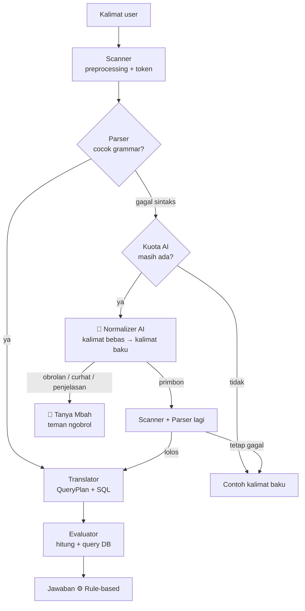

# Primbon NLP

Mesin penterjemah bahasa alami **berbasis aturan (rule-based)** untuk konsultasi **weton dan primbon Jawa**. User bertanya dalam bahasa Indonesia, mesin menerjemahkannya menjadi query SQL lewat empat tahap (**Scanner → Parser → Translator → Evaluator**), lalu menjawab beserta cara hitungnya.

> Tugas mata kuliah Kecerdasan Artifisial, Universitas Budi Luhur: *Mesin Penterjemah (Rule Based)* bertema kearifan lokal. Pola mesinnya mengikuti makalah *Aplikasi Pengolah Bahasa Alami untuk Info Gempa Bumi Terkini* (Indra & Sri Hartati, SNATI 2014).

## Contoh

| Pertanyaan | Jawaban |
|---|---|
| Apa weton orang yang lahir tanggal 17 Agustus 2003? | **Minggu Kliwon**, neptu 13, wuku Medangkungan, plus kartu weton: watak hari, pasaran, weton, dan wuku |
| Berapa neptu weton Senin Legi? | Senin (4) + Legi (5) = **9** |
| Apakah weton Senin Legi cocok dengan Jumat Kliwon? | 9 + 14 = 23 → 23 mod 9 = 5 → **Tinari** |
| Kapan Jumat Kliwon berikutnya? | **30 Oktober 2026** (dihitung dari 25 Oktober 2026) |
| Bagaimana watak orang dengan weton Rabu Pon? | Watak hari Rabu, pasaran Pon, dan weton Rabu Pon (wuku ikut jika tanggal lahir disebut) |
| Mbah, aku lagi capek banget… | 🤖 Mbah menemani curhat |
| lalu apa lagi? (setelah jawaban primbon) | 🤖 Mbah menjelaskan hasil sebelumnya lebih rinci |

## Peran AI dan rule-based

**AI menerjemahkan, rule-based menjawab.** Semua hitungan primbon selalu dikerjakan mesin rule-based. AI hanya dipakai saat kalimat user terlalu bebas untuk dikenali grammar, dan tugasnya sebatas menulis ulang kalimat itu menjadi kalimat baku.



| | Rule-based | AI |
|---|---|---|
| Mengenali kalimat baku | ✅ | ❌ tidak dipanggil |
| Mengenali kalimat bebas ("aku senin legi, pacarku jumat kliwon, cocok ga?") | ❌ | ✅ ditulis ulang jadi kalimat baku |
| Menghitung weton, neptu, jodoh, tanggal | ✅ selalu | ❌ tidak pernah |
| Memvalidasi hasil AI | ✅ kalimat AI wajib lolos Parser yang sama | ❌ |
| Ngobrol, curhat, pertanyaan umum, penjelasan hasil lebih rinci, dan pertanyaan tentang project | ❌ | ✅ Tanya Mbah (tanpa menghitung) |

Setiap jawaban diberi label: **⚙️ Rule-based**, **⚙️ Rule-based · 🤖 kalimat dirapikan AI**, atau **🤖 Mbah AI**. Panel tahapan menampilkan hasil tiap tahap, sehingga mudah dijelaskan saat presentasi.

## Empat tahap

1. **Scanner**: huruf kecil, buang tanda baca, normalisasi tanggal (`17/8/2003` → `17 agustus 2003`) dan sinonim (`ahad` → `minggu`, `manis` → `legi`), lalu memberi label tiap token (`KATA_TANYA`, `HARI`, `PASARAN`, `BULAN`, `ANGKA`, ...).
2. **Parser**: *recursive descent* mengikuti 14 aturan produksi (R1-R14), menghasilkan pohon parse dan nomor aturan yang dipakai.
3. **Translator**: mengubah pohon parse menjadi rencana query dan SQL berparameter.
4. **Evaluator**: menghitung hari pasaran dari tanggal (acuan 17 Agustus 1945 = Jumat Legi), menghitung wuku (acuan 17 Desember 2000 = awal Sinta), menjalankan query ke tabel `hari`, `pasaran`, `jodoh`, `watak`, `wuku`, lalu menyusun jawaban beserta cara hitung dan rinciannya. Jodoh memakai `(neptu_1 + neptu_2) mod 9` (sisa 0 dan 1 = Pegat), sesuai rentang angka di [Bisnis.com](https://kabar24.bisnis.com/read/20241106/243/1813354/cara-hitung-weton-jawa-untuk-pernikahan-agar-jauh-dari-bala), dengan arti kategori dari [Pegadaian](https://pegadaian.co.id/artikel/inspirasi/hitungan-weton-jawa-untuk-pernikahan).

Aturan produksi lengkap, rumus, dan tabel data ada di [`PRD.md`](./PRD.md) bagian 4-5.

## Fitur

- Chat primbon dengan 5 tipe kalimat dan panel tahapan.
- Normalizer AI untuk kalimat bebas, dengan pertanyaan lanjutan ("kalau sama rabu pon?").
- Tanya Mbah: AI teman ngobrol yang bisa diajak curhat, menjawab pertanyaan umum, menjelaskan hasil primbon lebih rinci, dan menjelaskan cara kerja project.
- Kartu weton lengkap: watak hari, pasaran, weton, dan wuku (siklus 210 hari), semuanya dijelaskan dengan bahasa awam beserta arti istilahnya.
- Saat menunggu jawaban, gunungan bergoyang dengan kata bergiliran seperti "Thinking…", "Pondering…", "Consulting the primbon…".
- Halaman login dengan panduan langkah demi langkah (bisa maju-mundur): satu kalimat contoh melewati keempat tahap, untuk kalimat baku maupun kalimat bebas yang dirapikan AI.
- Semua fitur wajib login. Ada akun **tamu** (username `tamu`, password `tamu`) dengan kuota AI kecil yang dipakai bersama, untuk dosen dan teman yang ingin mencoba.
- Admin: kelola user, AI (Base URL, API key, model utama dan cadangan), limit harian, kill switch, dan statistik rule-based vs AI.
- **Riwayat chat per akun**: mulai chat baru atau lanjutkan percakapan sebelumnya (panel kiri di desktop, tombol Riwayat di HP), lengkap dengan hapus percakapan. Tidak berlaku untuk akun tamu yang dipakai bersama.
- **Kirim gambar** (tombol lampiran atau Ctrl+V): foto berisi tanggal lahir, seperti akta, dibaca AI lalu dihitung rule-based; gambar lain ditanggapi Mbah. Gambar dikecilkan di browser dan disimpan di Storage privat.
- My profile: nama, foto, ganti password.

## Stack

- **Next.js 16.4.3** (App Router) + TypeScript
- **Tailwind CSS 4**, **motion** (motion.dev), **Animate UI**
- **Supabase**: Postgres, Auth, RLS, Storage, Vault
- **Vercel**, runtime Node.js 24.x
- AI: provider **OpenAI-compatible** (Base URL + API key diatur admin), dengan model utama dan model cadangan

## Dokumen

- [`PRD.md`](./PRD.md): spesifikasi produk, aturan produksi, rumus, skema data, dan peran AI.
- [`CARA_KERJA.md`](./CARA_KERJA.md): **bahan presentasi**, penjelasan tiap tahap dengan contoh jejak asli, aturan produksi, data, dan peran AI.
- [`UI_RULES.md`](./UI_RULES.md): aturan desain (warna, tipografi, unsur Jawa, animasi).

## Menjalankan secara lokal

> Bagian ini dilengkapi setelah scaffold dibuat.

```bash
npm install
cp .env.example .env.local   # lalu isi nilainya
npm run dev                  # http://localhost:3000
node --test                  # unit test mesin rule-based
```

Variabel lingkungan (nilai asli jangan pernah di-commit):

```bash
NEXT_PUBLIC_SUPABASE_URL=
NEXT_PUBLIC_SUPABASE_ANON_KEY=   # publishable key
SUPABASE_SERVICE_ROLE_KEY=       # hanya server, jangan pernah NEXT_PUBLIC_*
```

### Setup pertama

1. Terapkan migration di `supabase/migrations/`.
2. Buat akun admin pertama di Supabase Dashboard > Authentication > Add user, lalu jalankan:
   `update public.profiles set role = 'admin' where id = (select id from auth.users where email = '<email-admin>');`
3. Login sebagai admin, buka `/admin` > AI settings: isi Base URL, API key, model utama, dan model cadangan.

## Keamanan

- `.env*` masuk `.gitignore`. Service role key hanya dipakai di server.
- API key AI disimpan terenkripsi di Supabase Vault dan tidak pernah dikirim ke browser.
- SQL selalu berparameter. Tidak ada eksekusi SQL bebas.
- Semua tabel memakai Row Level Security.
- Hasil AI selalu divalidasi ulang oleh Parser rule-based.

## Penulis

Izvio Prijaya Mumin, Universitas Budi Luhur.

*Primbon adalah warisan budaya, bukan ramalan pasti.*
